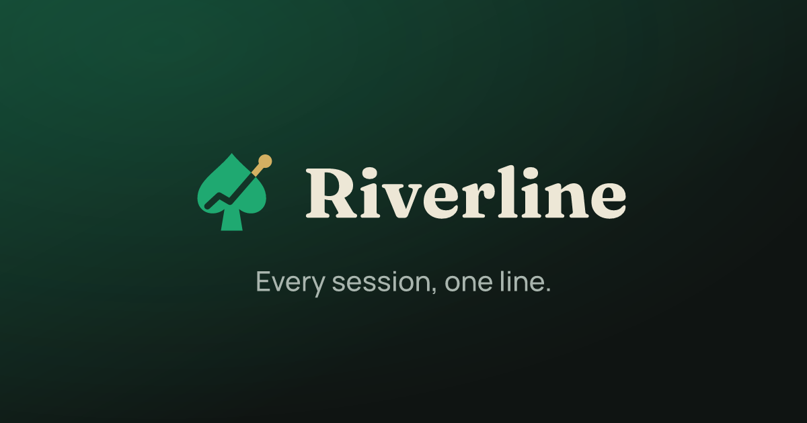

<p align="center">
  
</p>

# Riverline · Poker Companion

A poker companion web app for **recording your own session results** and **learning Texas Hold'em**. Track your lifetime net, see your trends in charts, and (coming soon) practice probability with a daily puzzle on a virtual poker table.

Riverline is for personal recordkeeping and education only. It never handles money, wagers or payments.

Brand guide, logos and icons: [`branding/BRAND.md`](branding/BRAND.md).

## What works today

- **Session tracker**: add, edit and delete sessions. Enter a net result directly, or record start and end amounts and let the app calculate the net. Optional duration, game type and notes.
- **Dashboard**: an animated lifetime net, 8 key stats, and a cumulative results chart (7D / 30D / 90D / Year / All).
- **History**: search notes, filter by date range, game type and result, and sort four ways.
- **Calendar**: a month view colored by daily result, where you can add a session for any day.
- **Analytics**: personal records, cumulative and monthly charts, an outcome donut, a GitHub-style yearly heatmap, and a game type comparison.
- **Daily puzzle**: a new probability challenge every day, generated from the UTC date, so everyone gets the same puzzle and refreshing never changes it.
  - It rotates through preflop, flop and turn situations with two or three players, filtered so no hand is a lock.
  - You predict each player's share of the pot with linked sliders, then see the exact answer, your accuracy, a plain-English explanation (including the exact river cards that change the winner), and can deal out random run-outs on an animated table.
  - It tracks your streak, average accuracy, best prediction and history.
- **Year in Review**: a Spotify Wrapped–style story of your year.
  - Seven animated full-screen slides: your year, the numbers (animated net result), most active month, session history, biggest session, learning progress, and a one-screen summary.
  - Slides auto-advance with pause, tap and keyboard navigation, and replay. The current year is labeled "year to date", and previous years are one tap away.
  - Save the summary card as a PNG or share it. A privacy setting (on by default) leaves every money amount off exported cards.
  - Slides without enough data are skipped rather than filled with made-up numbers.
- **Quizzes**: six categories (hand rankings, who wins, tie-breakers, rules, terminology, probability) at three difficulty levels, plus a five-question quick quiz.
  - Question styles: multiple choice, dealt showdowns on the table, picking the strongest hand or the winning river card, and number answers.
  - Hand questions are dealt fresh each time; the evaluator and equity engine compute every answer and explanation, and tests re-check 126 generated quizzes.
  - Missed questions go to a review list until you answer them correctly.
- **Achievements**: ten learning badges (lessons, quizzes, puzzles, streaks), shown on Profile with progress bars and an unlock pop-up. None are tied to session results or money.
- **Poker table**: a reusable oval table with 2–6 seats, a dealer button, a dealing animation, and winning-hand highlights.
- **Rules guide**: nine short lessons, from the deck to showdown, kickers and outs. Mark lessons complete; progress is saved and shown on Learn and Profile. Interactive examples include a deal you can step through street by street, a six-seat table that shows how the button and blinds move, showdowns you reveal, and an outs calculator.
- **Glossary**: 53 terms with examples and cross-linked related terms. Search covers names, aliases ("UTG", "OESD") and definitions, and lessons link straight to each entry.
- **Hand rankings**: all ten hands with real card examples, tie-break rules and how often each occurs.
- **Odds calculator**: pick hands for 2–6 players and any board. It gives exact win/split odds by checking every possible remaining board (heads-up preflop is all 1,712,304), names each player's current hand, and explains the winner at showdown. It runs in a Web Worker so the page stays responsive.
- **Demo mode**: fictional, clearly labeled data, stored separately from your real records.
- **Settings**: currency, dark and light themes, CSV export, and delete all.
- Responsive layout: bottom navigation on phones and a sidebar on desktop.

## Tech stack

| Area | Choice | Why |
| --- | --- | --- |
| UI | React 19 + TypeScript (strict) | Typed, component-based UI |
| Build | Vite | Fast dev server and builds |
| Styling | Tailwind CSS v4 with CSS-variable theme tokens | One palette drives light and dark themes |
| Charts | Recharts | Interactive, accessible SVG charts |
| Animation | Motion | Sheet, toast and hero transitions |
| Tests | Vitest | Fast unit tests for all calculation logic |

## Design decisions

- **Money is stored as integer cents.** Amounts are parsed from the typed digits, never by multiplying floats, so totals can't drift (`0.1 + 0.2` problems are impossible). Formatting to a currency happens only for display.
- **The poker engine is exact and verified.** Cards are integers, and a bit-mask hand evaluator scores any 5–7 cards. The tests prove it by:
  - counting all 2,598,960 five-card hands and matching the textbook total for every category (including exactly 4 royal flushes);
  - agreeing with a separate, deliberately simple evaluator on 20,000 random 7-card hands;
  - matching odds scenarios small enough to count by hand.
  Odds are never hard-coded or sampled.
- **Calculation logic is pure and separate from the UI.** `src/domain/analytics.ts` has no React or storage code, so every number on screen is unit-tested.
- **One source for the brand.** The logo, icons and social card are generated from a single definition of the mark and palette (`branding/tools`), so every asset matches.
- **Storage sits behind an interface.** `SessionRepository` is implemented with `localStorage` today. A cloud version (for example Supabase with row-level security, for accounts and multi-device sync) can replace it without touching any screen.
- **Stored data is validated when it's read back**, so a corrupt record is skipped instead of crashing the app.
- **CSV export guards against formula injection** in spreadsheet apps.

## Project structure

```
src/
  lib/          money (cents), dates, CSV: pure helpers
  domain/       session validation and analytics: pure, unit-tested
  poker/        cards, hand evaluator, exact equity engine, hand-ranking content
  learn/        lessons, glossary and probability math; every example is checked by tests
  puzzle/       daily puzzle generator (seeded by UTC date), scoring, streaks, explanations
  quiz/         question bank, engine-based question generators, quiz building and stats
  achievements/ achievement definitions computed from learning progress
  recap/        Year in Review stats, privacy-aware summary lines, canvas card export
  data/         storage interface, localStorage implementation, demo data
  state/        React providers: settings, sessions, toast, add/edit form
  components/   UI building blocks, charts, heatmap, calendar, app shell
  pages/        Home, Sessions, Profile, and the upcoming feature pages
```

## Getting started

```bash
git clone https://github.com/aaravbuddhadev-hash/poker-app.git
cd poker-app
npm install
npm run dev
```

Then open http://localhost:5173.

| Command | What it does |
| --- | --- |
| `npm run dev` | Start the dev server |
| `npm test` | Run the unit tests |
| `npm run build` | Type-check and build for production |
| `npm run lint` | Lint with oxlint |

## Roadmap

- [x] Phase 1: Architecture plan and branding concepts
- [x] Phase 2: Session tracker, dashboard, history, local storage
- [x] Phase 3: Analytics (cumulative, monthly, outcomes, heatmap, game types)
- [x] Phase 4: Hand rankings, rules guide, glossary
- [x] Phase 5: Hand evaluator, exact equity engine, hand comparison tool, animated poker table
- [x] Phase 6: Daily probability puzzle
- [x] Phase 7: Knowledge quizzes and achievements
- [x] Phase 8: Year in Review
- [x] Phase 9: Final branding: Riverline name, Breakout Spade logo, icons, splash
- [ ] Phase 10: Accounts and cloud sync, polish, deployment
