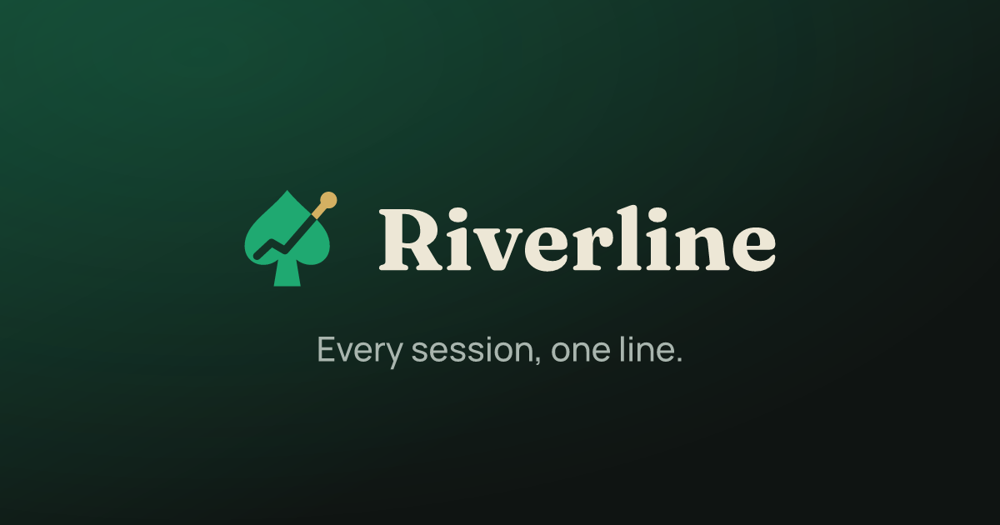
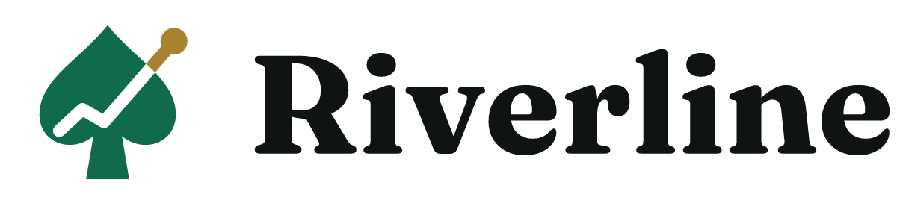

# Riverline brand guide

  

**Riverline** is a poker companion for recording sessions and learning the game. The name joins the *river* (the last community card) with a results *line*. The look is Direction A, "Premium Poker": a private card room crossed with a well-kept ledger. It's calm, precise and confident, never casino-loud.

**Tagline:** *Every session, one line.*

## Logo

The **Breakout Spade**: a spade with a results line cut through it. The line starts inside the spade, dips, then rises in one straight run that breaks out of the spade's edge and turns gold. It shows a player's results going up and past where they started.

| On dark | On light |
| --- | --- |
|  |  |

**Files** (in `final/`). Every SVG has outlined text, so no font is needed.

| Asset | SVG | PNG |
| --- | --- | --- |
| Logo, dark and light backgrounds | `svg/riverline-logo-{dark,light}.svg` | `png/riverline-logo-{dark,light}-1200.png` |
| Logo, one color | `svg/riverline-logo-mono-{white,black}.svg` | `png/…-1200.png` |
| Mark only | `svg/riverline-mark-{dark,light,mono-white,mono-black}.svg` | `png/…-512.png` |
| App icon (square, full bleed) | `svg/riverline-app-icon.svg` | `png/riverline-app-icon-1024.png` |
| App icon (rounded preview) | `svg/riverline-app-icon-rounded.svg` | `png/riverline-app-icon-rounded-1024.png` |
| Android maskable icon | `svg/riverline-app-icon-maskable.svg` | `public/icon-maskable-512.png` |
| Favicon | `svg/riverline-favicon.svg` | `public/favicon-32.png` |
| Social / link preview | `svg/riverline-social-card.svg` | `png/riverline-social-card-1200x630.png` |
| Portrait splash | `svg/riverline-splash-portrait.svg` | `png/riverline-splash-portrait-1290x2796.png` |

**Rules**
- Keep clear space around the logo equal to the height of the spade's stem (about ¼ of the mark's height).
- Minimum size: 20 px for the mark alone, 96 px wide for the full logo.
- Use the dark version on charcoal or felt, and the light version on cream or white. On photos or busy backgrounds, use a one-color version.
- Don't recolor the spade gold, rotate it, add effects, or redraw the line. The line always rises to the right.
- Gold is for the breakout only. Never fill the whole mark in gold.

## Color

| Role | Name | Hex | Use |
| --- | --- | --- | --- |
| Background | Charcoal | `#0F1412` | App background (dark) |
| Brand surface | Felt | `#123D2D` | Hero cards, icon background |
| Primary | Emerald | `#1FA971` | Buttons, active navigation, the spade |
| Accent | Gold | `#D4B062` | The breakout, highlights, eyebrow labels (sparingly) |
| Text | Cream | `#EDE7D6` | Main text on dark |
| Light background | Paper | `#F6F2E8` | App background (light theme) |
| Emerald (light) | Deep emerald | `#0F6B4A` | Primary color on light backgrounds |
| Gold (light) | Deep gold | `#A8832F` | Accent on light backgrounds |

**Results colors** are separate from the brand colors. Positive is `#3DD68C` (dark) / `#0F7A4C` (light), negative is `#F0675D` / `#B93A2E`, and break-even is a neutral gray-green. Never use brand emerald to mean "positive result", so the two never get confused.

The full set of theme colors lives in `src/index.css` (and is mirrored for charts in `src/components/theme.ts`).

## Typography

| Role | Typeface | Weights | Use |
| --- | --- | --- | --- |
| Display | **Fraunces** | 700 (500 for subheads) | Wordmark, page titles, the big lifetime number |
| Interface | **Manrope** | 400–700 | Everything else: labels, body text, buttons, tables |

Both are free Google Fonts (SIL Open Font License). Numbers that line up in columns use tabular figures. Eyebrow labels are Manrope 600, uppercase, with 0.14em letter spacing, in gold.

## Voice

Plain, specific and calm. Write like a knowledgeable friend at the table, not a casino promoter.
- Say "record a session" and "net result", never "bet", "wager" or "cash out". Riverline never handles money.
- Use real numbers. Don't hype them, and never invent statistics.
- Errors say what went wrong and how to fix it.

## Regenerating the assets

Every file in `final/` and the icons in `public/` are generated by [`tools/build-brand-assets.mjs`](tools/build-brand-assets.mjs) from a single definition of the mark and the palette. Instructions are at the top of that file.
